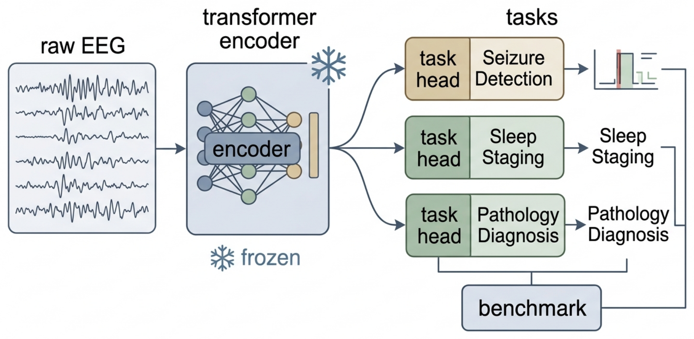
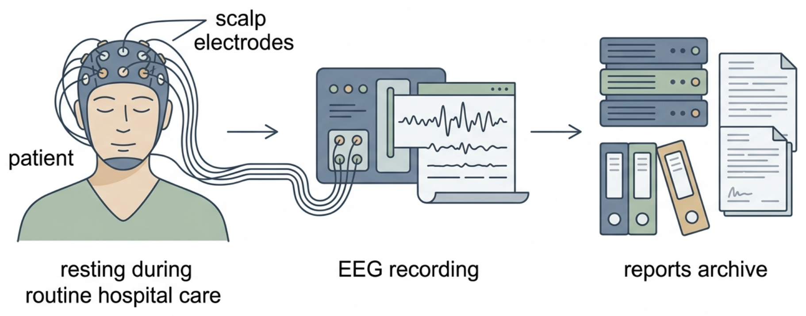

# EEG Foundation Model Benchmark

This independent research repository plans and tracks a benchmark of self-supervised EEG foundation models across clinical downstream tasks, using the Temple University EEG Corpus family. It provides evaluation utilities for transparent review and extension.

## Introduction

Self-supervised learning could make EEG foundation models useful in clinical settings where labeled examples are scarce but unlabeled recordings are abundant. This repository tests that claim by pretraining a compact transformer encoder with channel-masked reconstruction and comparing it with an identical from-scratch model on held-out classification tasks.



*Figure 1. Benchmark concept: stage EDF recordings into a canonical montage, pretrain an encoder on unlabeled windows, then compare linear-probe and from-scratch evaluation on clinical downstream tasks.*

**Current status:** implementation stage. The SSL framework (channel-masked reconstruction pretraining, linear-probe/fine-tune evaluation, benchmark runner) is implemented and validated on synthetic EEG; the corpus staging pipeline (`eegfm.tuh` + `scripts/`) is implemented and validated end-to-end on real public EEG (PhysioNet eegmmidb, open access — see `reports/`); the TUEG license request remains open as issue #1; no TUH corpus experiments have been run.

## Extended introduction

The full background, research questions, and clinical-benchmark rationale are in [docs/INTRODUCTION.md](docs/INTRODUCTION.md) and [docs/EXTENDED_INTRODUCTION.md](docs/EXTENDED_INTRODUCTION.md). The extended introduction explains why subject-wise splitting, cross-channel structure, and explicit negative-result reporting are central to the benchmark design.



*Figure 2. Data-collection and staging overview. TUH access is DUA-gated; the public eegmmidb path is used only to validate the pipeline before TUH experiments begin.*

## Materials and methods

The implemented pipeline uses a channel×time patch transformer encoder, MAE-style channel-masked reconstruction pretraining, linear-probe and fine-tune evaluation, and AUROC/AUPRC reporting. EDF staging normalizes channel labels to the canonical 19-channel 10-20 montage, resamples to 128 Hz, and extracts fixed-length windows with an integrity manifest. The design decisions and statistical hygiene rules are documented in [docs/METHODS.md](docs/METHODS.md); TUH access requirements are documented in [docs/DATA_ACCESS.md](docs/DATA_ACCESS.md).

### Research plan and issue map

| Issue | Atomic subtask | Depends on | Status |
|---|---|---|---|
| #1 | Obtain TUEG license and document terms | — | Open |
| #3 | EEG preprocessing pipeline with synthetic tests | — | Closed |
| #8 | Pre-register SSL pretraining plan and config | #1, #3 | Open |
| #9 | Implement SSL pretraining pipeline with synthetic smoke test | #8 | Open |
| #6 | Run TUEG pretraining and version checkpoints | #9 | Open |
| #7 | Document pretraining run summary and checkpoint manifest | #6 | Open |
| #4 | Pretrain/fine-tune SSL encoder on TUEG | #1, #3; tracked by #8/#9/#6/#7 | Open umbrella |
| #11 | Benchmark harness with pre-registered metrics and fixed splits | #4 | Open |
| #10 | Benchmark encoder vs baselines on TUSZ and TUAB | #11 | Open |
| #12 | Benchmark encoder vs baselines on Sleep-EDF and CHB-MIT | #11 | Open |
| #13 | Assemble leaderboard with CIs and session/window ablation | #10, #12 | Open |
| #5 | Cross-task benchmark vs task-specific baselines | #4; tracked by #11/#10/#12/#13 | Open umbrella |
| #16 | Figure scripts for Paper 1 results package | #5 | Open |
| #15 | Release one-command evaluation harness for Papers 2–4 | #5 | Open |
| #17 | Reproducibility re-run of leaderboard from clean checkout | #15 | Open |
| #14 | Draft Paper 1 manuscript outline | #16 | Open |
| #2 | Assemble results package, harness, and manuscript outline | #5; tracked by #16/#15/#17/#14 | Open umbrella |
| #19 | Convert mixed and placeholder docstrings to Google style | — | Open |

*Dependency note:* the table records the actual task graph. Two older issue bodies refer to the closed preprocessing task as “#2”; the preprocessing issue in this repository is #3, while #2 is the results-package umbrella.

## Results

Paper-style results live in [docs/RESULTS.md](docs/RESULTS.md). The committed public-EEG validation shows that the staging and pretraining pipeline runs end-to-end, while the tiny two-subject benchmark is explicitly **not** evidence of method superiority.

| Result | Value | Interpretation |
|---|---:|---|
| Public-EEG pretraining loss | 0.981 → 0.933 over 15 epochs | Pipeline learns on real public EEG. |
| SSL-pretrained + linear probe | AUROC 0.734; AUPRC 0.615 | Validates the benchmark path on the small public demo. |
| From-scratch supervised | AUROC 0.918; AUPRC 0.880 | Wins on the tiny two-subject demo; reported as-is. |

*Table 1. Headline public-data validation from the committed `reports/` artifacts. See [docs/RESULTS.md](docs/RESULTS.md) for captioned tables, planned result shells, and this run's validation record.*

The separate root-level [results.md](results.md) is retained as a test-robustness note: it documents that the suite passes in isolation but that the benchmark test is not robust under resource contention.

## What is included

| Path | Contents |
|---|---|
| `src/eegfm/data.py` | EEG window dataset interface; channel-set standardization (canonical 10-20 montage harmonization). |
| `src/eegfm/simulate.py` | Synthetic EEG generator with planted class-discriminative cross-channel phase-coupling patterns. |
| `src/eegfm/models.py` | Compact transformer encoder (channel×time patch embedding, positional encoding), linear probe head, channel-masked reconstruction wrapper. |
| `src/eegfm/pretrain.py` | MAE-style channel-masked reconstruction SSL pretraining loop. |
| `src/eegfm/finetune.py` | Linear-probe (frozen encoder) and fine-tune (unfrozen) evaluation. |
| `src/eegfm/benchmark.py` | Benchmark runner: SSL-pretrained probe vs. from-scratch supervised baseline; AUROC/AUPRC results table. |
| `src/eegfm/tuh.py` | TUH (TUEG/TUAB/TUSZ) EDF staging: channel-label normalization to the canonical montage, resampling, windowing, integrity manifest; raises a clear access error when the DUA-gated corpus is absent. Includes a credential-free public download path (PhysioNet eegmmidb, ODC-BY). |
| `scripts/prepare_tueg.py` | One-command corpus staging: EDF tree → `windows.npz` + `manifest.csv` (`--raw-root` for TUH, `--public-demo` for eegmmidb). |
| `scripts/run_pretrain.py` | One-command SSL pretraining on staged windows; saves `encoder.pt` + loss history. |
| `scripts/run_benchmark.py` | One-command benchmark on staged labeled windows (`--public-demo-task`: eyes-open vs eyes-closed on eegmmidb) or synthetic data. |
| `tests/` | Synthetic-signal tests: forward shapes, pretraining loss reduction, pretrained probe beats from-scratch baseline; EDF staging tests on synthetic EDF fixtures. |
| `reports/` | Small derived results from the public-data validation run (eegmmidb): pretraining loss history and benchmark table. |
| `docs/` | Research status, methods scope, data access (TUH DUA) guidance, paper-style results, and contribution guidance. |

## Use and validation

```bash
pip install -e ".[dev]"
python -m pytest -q
```

All tests run on CPU using synthetic signals; no corpus access is required. The EDF staging tests are skipped unless the optional `pyedflib` dependency is installed. See [docs/DATA_ACCESS.md](docs/DATA_ACCESS.md) for TUH EEG Corpus access (free for research, signed DUA with Temple University required).

## One-command pipeline

With TUH access (after DUA approval):

```bash
pip install -e ".[dev,edf]"   # EDF reading uses pyedflib (or mne)
python scripts/prepare_tueg.py --raw-root /path/to/tuh_eeg --out data/tueg_windows
python scripts/run_pretrain.py --windows data/tueg_windows/windows.npz
```

Credential-free validation on real public EEG (PhysioNet eegmmidb):

```bash
python scripts/prepare_tueg.py --public-demo --out data/demo_windows
python scripts/run_pretrain.py --windows data/demo_windows/windows.npz
python scripts/run_benchmark.py --public-demo-task
```

The public-demo benchmark classifies baseline eyes-open vs eyes-closed windows (eegmmidb runs R01/R02, 2 subjects, 120 task windows, 19 canonical channels); the latest run is in `reports/`.

## Keywords

EEG, foundation models, self-supervised learning, seizure detection, clinical neurophysiology, computational neuroscience, reproducible research.

## Documentation

- [Introduction for new readers](docs/INTRODUCTION.md)
- [Extended introduction](docs/EXTENDED_INTRODUCTION.md)
- [Materials and methods](docs/METHODS.md)
- [Paper-style results](docs/RESULTS.md)
- [TUH EEG Corpus data access](docs/DATA_ACCESS.md)
- [Test-robustness note](results.md)
- [Contributing](CONTRIBUTING.md)
