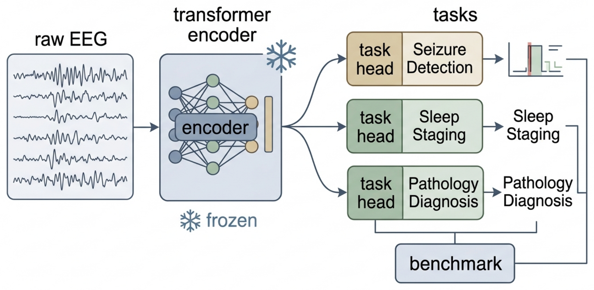

# Results

**Scope.** This file separates completed, committed results from pre-registered result shells. The public-EEG numbers below come from committed artifacts under `reports/`; no TUH EEG Corpus experiment has been run. The root-level [../results.md](../results.md) remains a separate test-robustness note.

## Completed validation results

| Quantity | Value | Source | Interpretation |
|---|---:|---|---|
| Public validation corpus | PhysioNet eegmmidb (ODC-BY) | `docs/METHODS.md`; `src/eegfm/tuh.py` | Credential-free real-EEG stand-in used to exercise the pipeline before TUH access. |
| Staged pretraining windows | 243 | `docs/METHODS.md` | Real EDF recordings staged into the canonical 19-channel montage. |
| Pretraining epochs | 15 | `reports/pretrain_history_eegmmidb.csv` | Small validation run, not a scaled pretraining claim. |
| Initial reconstruction MSE | 0.9808 | `reports/pretrain_history_eegmmidb.csv` | Epoch 1 channel-masked reconstruction loss. |
| Final reconstruction MSE | 0.9326 | `reports/pretrain_history_eegmmidb.csv` | Epoch 15 channel-masked reconstruction loss. |
| Relative MSE reduction | 4.9% | Computed from the committed history | The implemented SSL loop trains on real public EEG. |

*Table 1. Public-EEG pretraining validation. This establishes that EDF staging and channel-masked reconstruction run end-to-end on real EEG; it does not establish downstream utility.*

| Method | AUROC | AUPRC | Honest reading |
|---|---:|---:|---|
| SSL-pretrained + linear probe | 0.734 | 0.615 | The frozen pretrained representation is above chance on the tiny public demo. |
| From-scratch supervised | 0.918 | 0.880 | The from-scratch baseline wins this two-subject eyes-open/eyes-closed task. |

*Table 2. Public-EEG benchmark validation from `reports/benchmark_results_eegmmidb.csv`. The task uses 120 baseline windows from two subjects and is a pipeline smoke test; it is not evidence that the SSL method is superior. This negative comparison is reported explicitly.*

*Figure 1. Benchmark concept: EDF staging into a canonical montage, SSL pretraining on unlabeled windows, and downstream linear-probe/fine-tune evaluation. Committed under `docs/figures/`.*

## Pre-registered result shells

| Planned result | Required content | Authorizing issue | Status |
|---|---|---|---|
| TUEG pretraining run summary | Final loss curve, deviations from the registered plan, checkpoint locations, checkpoint hashes, and compute log. | #6, #7 | Pending TUEG access and pretraining. |
| Checkpoint manifest | Content hashes for every encoder checkpoint used by Papers 2–4. | #6, #7 | Pending. |
| Public-demo loss figure | One-command figure generated from `reports/pretrain_history_eegmmidb.csv`. | #16 | Figure scripts pending. |

*Table 3. Pretraining result package. Empty cells are intentional pre-registered placeholders, not missing results.*

| Evaluation component | Registered output | Authorizing issue | Status |
|---|---|---|---|
| Benchmark harness | Pre-registered per-task metrics and fixed splits in `configs/`; runnable evaluation entry point. | #11 | Pending TUEG pretraining. |
| TUSZ seizure detection | Per-task table with AUROC, AUPRC, balanced accuracy, split manifest, and negative results if observed. | #10 | Pending harness. |
| TUAB abnormality detection | Per-task table with AUROC, AUPRC, balanced accuracy, split manifest, and negative results if observed. | #10 | Pending harness. |
| Sleep-EDF staging | Per-task table under the same harness and fixed-split rules. | #12 | Pending harness. |
| CHB-MIT validation | Per-task table under the same harness and fixed-split rules. | #12 | Pending harness. |

*Table 4. Cross-task benchmark result shells. No TUAB/TUSZ/Sleep-EDF/CHB-MIT result is claimed before the corresponding issue closes.*

| Model | Task | Metric | Estimate | 95% CI | Split | Status |
|---|---|---|---|---|---|---|
| SSL encoder + linear probe | TUSZ | AUROC/AUPRC | — | — | Fixed subject-wise split | Pending #10 |
| SSL encoder + fine-tune | TUSZ | AUROC/AUPRC | — | — | Fixed subject-wise split | Pending #10 |
| Task-specific baseline | TUSZ | AUROC/AUPRC | — | — | Fixed subject-wise split | Pending #10 |
| SSL encoder + linear probe | TUAB | AUROC/AUPRC | — | — | Fixed subject-wise split | Pending #10 |
| SSL encoder + fine-tune | TUAB | AUROC/AUPRC | — | — | Fixed subject-wise split | Pending #10 |
| Task-specific baseline | TUAB | AUROC/AUPRC | — | — | Fixed subject-wise split | Pending #10 |
| Session-scale model | Ablation | Task metrics | — | — | Fixed subject-wise split | Pending #13 |
| Window-level model | Ablation | Task metrics | — | — | Fixed subject-wise split | Pending #13 |

*Table 5. Pre-registered leaderboard and ablation shell for issue #13. Confidence intervals must be resampled by subject, not by window, per `docs/METHODS.md`.*

| Package component | Planned content | Authorizing issue | Status |
|---|---|---|---|
| Paper 1 figure scripts | One script per figure, reading committed result tables only. | #16 | Blocked by #5. |
| Evaluation harness release | One-command leaderboard reproduction for Papers 2–4. | #15 | Blocked by #5. |
| Clean-checkout re-run | Reproduced leaderboard diffed against committed results, with mismatches explained. | #17 | Blocked by #15. |
| Manuscript outline | Section-by-section Paper 1 outline with claims mapped to committed tables/figures. | #14 | Blocked by #16. |

*Table 6. Results-package shell under umbrella issue #2. Drafting and release tasks do not authorize new empirical claims.*

## Validation record

| Branch | Commit | Command | Result | Environment | Notes |
|---|---|---|---|---|---|
| `main` | `74392c3` | `PYTHONPATH=$PWD:$PWD/src python -m pytest -q` | 13 passed, 1 skipped, 0 failed (19.52 s) | Python 3.12.12, CPU, torch 2.8.0+cu128, numpy 2.2.5, pandas 2.3.2, scipy 1.16.2, scikit-learn 1.7.2, pytest 9.2.0 | `tests/test_tuh.py` skipped because optional `pyedflib` is not installed. |
| `fix/seeded-benchmark-init` | `d1065be` | `PYTHONPATH=$PWD:$PWD/src python -m pytest -q` | 13 passed, 1 skipped, 0 failed (17.48 s) | Same as above | Branch code tree matches the seeded-benchmark fix already merged into `main`; it lacks only the later root `results.md` documentation commits. |
| `main` | `d7b7207` | `PYTHONPATH=$PWD:$PWD/src python -m pytest -q` | 17 passed, 0 skipped, 0 failed (22.2 s) | Python 3.12.12, CPU, torch 2.8.0+cu128, numpy 2.2.5, pandas 2.3.2, scipy 1.16.2, scikit-learn 1.7.2, pytest 9.2.0, pyedflib 0.1.42 | Post-#19 (Google-style docstrings) and #20 part 1 (benchmark-test hardening) tree; pyedflib installed, so the four `tests/test_tuh.py` EDF staging tests run instead of skipping. |

*Table 7. Cheap-test audits (2026-11-17). Heavy compute — TUEG pretraining (#6), cross-task benchmarks (#10/#12), and leaderboard reproduction (#17) — is deferred: needs environment/data and issue-gated corpus access.*

## Negative and boundary results

- The from-scratch supervised model outperforms the SSL-pretrained linear probe on the tiny public eegmmidb demo (Table 2). This is reported as a pipeline-validation result, not as a claim about scaled pretraining.
- No TUH EEG Corpus result exists yet; TUEG access remains issue #1 and all TUH experiments are blocked until the DUA path is complete.
- No clinical claim is supported by the current synthetic or public-demo validations.
- The docstring-style gap (issue #19) was closed on 2026-11-17: every public module, class, function, and method across `src/`, `scripts/`, and `tests/` now carries a Google-style docstring. The change was documentation-only, verified logic-identical by docstring-stripped AST comparison against the pre-change tree.
- The root-level [../results.md](../results.md) documents a separate robustness finding: the benchmark test passed in isolation but was not robust under resource contention. That note concerns test reliability, not a scientific result. Two of its three recommendations are implemented in issue #20 (single-thread pinning and a declared wall-clock budget in `tests/test_benchmark.py`); the third — a CI workflow under `.github/workflows/` — could not be pushed by the automation token (missing `workflow` scope) and awaits owner action, with the exact YAML attached to issue #20.
